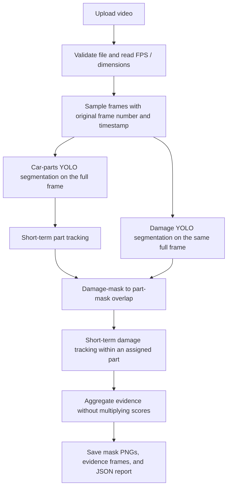

# Video-Based Car Damage Detection Pipeline

This is a modular first implementation for your two uploaded notebooks. It runs both trained YOLO segmentation models on sampled **original video frames**, matches damage masks with part masks, tracks observations over nearby frames, saves evidence masks/frames, and writes `damage_report.json`.

## What the uploaded notebooks actually establish

### Car parts notebook

- Checkpoint: `/content/drive/MyDrive/merged_carparts_models/FINAL_best.pt`
- The notebook's checkpoint inspection reports `task=segment`, 25 classes, and approximately 22.8 MB.
- Training starts from `yolov8s-seg.pt`, at `imgsz=640`.
- Reported classes are listed in `models/README.md`.
- Its shown image inference reads class names, confidence scores, and boxes; the checkpoint inspection confirms it is a segmentation model, so the reusable implementation reads instance masks too.

### Damage notebook

- Trains `yolov8n-seg.pt` with `ultralytics==8.4.182`, `imgsz=640`, and a single class named `damage`.
- The notebook's intended final deployment checkpoint is `/content/drive/MyDrive/datasets/car_damage_training_output/best_damage_model.pt`.
- It also copies `best.pt` to `/content/drive/MyDrive/datasets/car_damage_training_output/checkpoints/best.pt` after completed training epochs.
- The attached notebook output stops during epoch 93/100. It does **not** prove that the final copy step ran. See `models/README.md` and verify the real checkpoint in Drive before running.
- Because this model is trained with one generic class, this application reports `damage_type: "unknown"` and `model_label: "damage"`; it does not claim to distinguish scratches from dents or cracks.

The notebooks were run with Ultralytics 8.4.162 (parts) and 8.4.182 (damage). This project uses 8.4.182 for a single runtime; smoke-test both checkpoints before relying on the results.

## Recommended architecture



### Why this hybrid is the best starting point

Run both models on the same sampled original frame. The notebooks show both are segmentation models, so compare masks after scaling them to the original decoded frame dimensions. Do not send a tiny scratch-only crop to the part model: that crop can lack the context needed to identify the bumper, door, or hood. Mask-to-mask overlap is more informative than bounding-box intersection alone. The pipeline only uses boxes as a fallback when a mask is unavailable, and flags that in the association metadata.

| Strategy | Accuracy potential | Speed | Robustness | Complexity / main limitation |
|---|---|---|---|---|
| Part-first, damage on each part crop | Could help a damage model focus on a part, but may lose small edge damage or context | Usually slower due to many crops | Sensitive to crop padding/resizing | Not recommended as the first integration; validate crop inference separately |
| Damage-first, classify a tiny damage crop | Crop often lacks enough part context | Potentially fewer part-model calls, but crops add work | Fragile for scratches/small masks and part boundaries | Not recommended by itself |
| Both models on each full frame + mask matching | Strong baseline for the supplied segmentation checkpoints | Two inferences per selected frame | Uses whole-car context and pixel-level geometry | Simple and auditable; part-mask errors still affect associations |
| Hybrid + tracking + evidence aggregation | Best overall fit for the current project | Higher total compute than running one model | Reduces near-frame duplicates; can still split across large view changes | Moderate complexity; cross-view identity needs additional logic/validation |

## 1. Set up the project

Use Python 3.11 or another Python version on which PyTorch and the installed Ultralytics version are supported. The notebooks themselves ran under Python 3.13.15, PyTorch 2.11.0, and a Tesla T4, but your local environment must be checked independently.

### Windows PowerShell

From the extracted `car_damage_video_pipeline` directory:

```powershell
py -3.11 -m venv .venv
.\.venv\Scripts\Activate.ps1
python -m pip install --upgrade pip
pip install -r requirements.txt
Copy-Item .env.example .env
```

For GPU inference, install the PyTorch build appropriate for your NVIDIA driver/CUDA setup using the official PyTorch installation selector, then install the remaining dependencies. Do not blindly replace a working GPU PyTorch installation. On CPU, the pipeline will still run but may be slow.

### Put the model files in place

Copy (do not rename/overwrite your only backup of) the parts checkpoint to `models/car_parts.pt`. Copy the verified damage `best_damage_model.pt` to `models/car_damage.pt`; if the final deployment file is missing, use the notebook's `checkpoints/best.pt` only after verifying it loads and running validation.

Edit `.env` as needed. Initial settings are intentionally configurable:

- `SAMPLE_FPS=2.0`: about two frames per second. This is a starting point, not a guarantee against brief missed damage.
- `DAMAGE_CONF=0.10`: lower detection threshold intended to retain small candidates for review. Expect more false positives and tune it against labelled videos.
- `PARTS_CONF=0.25`: close to the parts notebook's shown inference threshold.
- `MIN_DAMAGE_COVERAGE=0.25`: at least 25% of the damage mask must be inside a part mask to consider an association.
- `MIN_REPEAT_OBSERVATIONS=2`: an assigned damage region is labelled confirmed only when it appears in at least two sampled observations, its model score is above the review threshold, and the part association is not ambiguous. A single-frame hit is retained but flagged for review; it is **not silently dropped**.

These thresholds are starter settings, not calibrated settings. Use the validation process below before making operational decisions.

## 2. Verify checkpoints before running a video

```powershell
python scripts/check_models.py
```

Optional one-frame test:

```powershell
python scripts/check_models.py --image path\to\car_image.jpg
```

Confirm that both tasks print as `segment`, the car-parts checkpoint reports 25 expected classes, and both models return compatible masks on your sample. This test must pass before video processing can work. Model files are not embedded in this project ZIP; only the notebooks were provided here.

## 3. Run from Python

Create `run_video.py` in the project root:

```python
from app.config import PipelineConfig
from app.pipeline import VideoDamagePipeline

config = PipelineConfig()
pipeline = VideoDamagePipeline(config)
pipeline.load_models()  # load checkpoints once, not once per frame
report = pipeline.analyze_video(
    r"videos\accident.mp4",
    output_dir=r"data\artifacts\demo_001",
    video_id="demo_001",
)
print(report["summary"])
print(r"data\artifacts\demo_001\damage_report.json")
```

Run it:

```powershell
python run_video.py
```

Outputs go under the specified artifact directory:

```text
data/artifacts/demo_001/
  damage_report.json
  damage_masks/
    damage_0001_mask.png
  evidence_frames/
    frame_000120_t_0004.000s.jpg
```

The frame filename in this illustration is an example only; actual evidence frames depend on predictions. The PNG mask is full-frame binary evidence for the selected representative observation. The JPEG overlay shows predicted parts and damage boxes/masks.

## 4. Run the API

`.env` values are loaded by Uvicorn when `python-dotenv` is installed. Start the API from the project root:

```powershell
uvicorn app.api:app --host 127.0.0.1 --port 8000 --env-file .env
```

Check the checkpoints:

```text
GET http://127.0.0.1:8000/health
```

Upload a video using `POST /api/jobs` as multipart form data with the file field named `video`. Example with `curl`:

```bash
curl -X POST "http://127.0.0.1:8000/api/jobs" -F "video=@videos/accident.mp4"
```

The response contains `job_id`, `status_url`, and `report_url`. Poll `GET /api/jobs/{job_id}` until status is `completed` or `failed`, then fetch `GET /api/jobs/{job_id}/report`. Evidence can be opened under the returned `artifacts_base_url`, for example `.../evidence_frames/<actual-file-name>.jpg` or `.../damage_masks/<actual-mask-name>.png`.

The API's job state is in memory and `BackgroundTasks` is intended here as a local prototype only. Restarting the process loses job status, and one process serializes GPU work. For a deployed multi-worker service, use persistent job metadata and a durable queue/worker. Keep uploads private, impose retention/cleanup limits, and do not expose raw uploaded videos through the public artifacts route.

## 5. How the masks are associated

Every sampled frame is passed to both models at its full decoded size. Ultralytics applies inference preprocessing internally. `retina_masks=True` asks for masks at original image resolution; a resize-to-original fallback remains in the code. Bounding boxes are also in original-frame coordinates.

For each damage mask and each part mask, the code computes:

- **Damage coverage** = intersection pixels / damage-mask pixels. This answers “how much of the damage lies inside the part?”
- **Mask IoU** = intersection pixels / union pixels. Useful for comparing two similarly sized regions, but for damage inside a much larger bumper its IoU will naturally be small.
- **Bounding-box fallback** = used only when one mask is absent; the report preserves the method and this should be reviewed.

If no part reaches the coverage threshold, or two parts are nearly tied within `AMBIGUITY_MARGIN`, the region is left unassigned/ambiguous and sent to `review_required` instead of selecting a part just because boxes intersect.

## 6. Detection vs tracking vs unique part counts

- **Detection**: one model output in one sampled frame.
- **Tracking**: a short-term association of detections between nearby sampled frames using same class and box/mask overlap.
- **Unique damaged part**: a tracked part instance that has at least one associated damage region. It is a track-level estimate, not a guaranteed count of physical components across every camera viewpoint.

The starter tracker does not rely on box/mask overlap alone for every final part count. It rejoins short-term track fragments by class for selected taxonomy labels that represent a single component per vehicle (for example, `front_bumper`, `hood`, and `back_bumper`). It deliberately does not merge repeated classes such as `wheel`, generic door labels, `front_fender`, or `quarter_panel`, because those can represent different physical instances. This reduces duplicate part counts across wide camera-angle changes without pretending to solve full 360-degree identity. Damage regions on the same rejoined bumper can still remain as two region tracks if the camera viewpoint changes substantially; reliable cross-view damage-surface re-identification would need a validated vehicle-side/orientation step, appearance embeddings, or a canonical vehicle-coordinate map.

Repeated model outputs are **not statistically independent confirmations**. The report retains per-frame scores and counts support frames, but does not multiply probabilities or manufacture a higher score. A high-scoring region visible only once stays in the report as uncertain/review-required. Small masks are not discarded by an arbitrary minimum-area rule.

## 7. JSON report structure

The generated report has these main fields:

```json
{
  "schema_version": "1.0",
  "video_id": "demo_001",
  "processing_status": "completed",
  "summary": {
    "unique_damaged_parts": 1,
    "confirmed_damaged_parts": 1,
    "total_damage_regions": 2,
    "confirmed_damage_regions": 1,
    "uncertain_damage_regions": 1,
    "unassigned_damage_regions": 0
  },
  "damaged_parts": [
    {
      "part_instance_id": "part_track_000001",
      "part_name": "front_bumper",
      "part_confidence": 0.85,
      "damage_status": "detected",
      "damage_regions": []
    }
  ],
  "unassigned_damage_regions": [],
  "review_required": []
}
```

Numbers above are illustrative only; never substitute them for the actual report. The actual region records contain `damage_id`, generic `damage_type: "unknown"`, raw model score, bbox in original coordinates, first/last timestamps, representative frame, mask path, evidence frame list, candidate parts, and review reasons. `unique_damaged_parts` counts assigned tracked component instances, not distinct class labels. An unassigned mask contributes to `total_damage_regions` but not to `unique_damaged_parts`.

## 8. Testing and calibration

Run the geometry tests after installing requirements:

```powershell
python -m unittest discover -s tests -v
```

Then check several **annotated validation videos**, including: no damage; one small damage visible briefly; a single bumper shown across many consecutive frames; two damages on one part; damage at a part boundary; two separate wheels/doors of the same class; strong viewpoint changes; occlusion; changing light/reflections; blur; and a car with multiple damaged parts.

For each video, manually annotate damage masks/boxes, part identity, timestamps, and physical part instances. Compare a baseline configuration and a changed configuration on the exact same held-out clips. Track at least:

- Damage mask precision/recall and mask AP or IoU at chosen thresholds.
- Part segmentation mask IoU / per-class recall.
- Correct damage-to-part assignment accuracy and ambiguity rate.
- Frame-level duplicate suppression and damage-track precision/recall.
- Unique damaged-part count error (absolute count error) per video.
- False positives per minute and the fraction of cases routed to manual review.
- Recall for small/brief damage and performance by view/lighting condition.

Tune `DAMAGE_CONF` to trade recall and false positives; tune association coverage/margin separately; tune tracking IoU/gap on videos with continuous movement. Never choose thresholds just because the example video looks good. Keep one validation set separate from the final test set.

## 9. Performance and limitations

- With `SAMPLE_FPS=2`, both models run on approximately two frames per second, so a 90-second video yields roughly 180 sampled frames and about 360 model inferences. Raising the rate helps brief damage but costs time.
- The models are loaded once and not per frame. The model calls are sequential to reduce memory pressure; avoid two concurrent jobs on the same GPU in this starter service.
- Model inference uses `imgsz=640`, matching the notebook training settings. Very small damage may still be lost at this resolution; if validation shows this, test an additional higher-resolution or targeted second pass, rather than blindly increasing all video inference cost.
- There is no hand-coded minimum damage area. Reflections, shadows, dirt, highlights, and texture can still produce false positives.
- A segmentation mask shows what the model predicted; it does not guarantee a damage diagnosis.
- This pipeline has not been run against your actual `.pt` checkpoint files because only the notebooks were attached. The first required runtime check is `scripts/check_models.py`; after the two checkpoints are in `models/`, use a test image and then a short test video.

## 10. React frontend

A React + Vite frontend is included in `frontend/`. It uploads the video to the existing FastAPI `POST /api/jobs` endpoint, polls `GET /api/jobs/{job_id}` while the job runs, fetches `GET /api/jobs/{job_id}/report`, and renders a table with exactly two columns: **Damage part name** and **Number of damaged parts**. The count is the number of assigned part instances grouped by `part_name` from the pipeline report; it is not a count of separate damage regions.

### Start the backend

From the project root, activate the project's Python virtual environment and run:

```powershell
uvicorn app.api:app --host 127.0.0.1 --port 8000 --env-file .env
```

Keep this terminal open. Check `http://127.0.0.1:8000/health` and confirm both checkpoints are found.

### Start the frontend

Open a second PowerShell terminal:

```powershell
cd frontend
npm install
npm run dev
```

Open `http://127.0.0.1:5173`. Vite proxies `/api`, `/health`, and `/artifacts` to the local FastAPI server on port 8000. If the frontend is hosted separately, set `VITE_API_BASE_URL` to the API origin (for example `http://127.0.0.1:8000`) and set the backend `CORS_ORIGINS` environment variable to the frontend's exact origin. Never use an unrestricted CORS origin for a public service.

### Frontend behavior

- Supports the same extensions as the API: MP4, MOV, AVI, MKV, WEBM, and M4V.
- Shows upload/processing/failed/completed states and handles API errors.
- Aggregates `report.damaged_parts` by part name and counts `part_instance_id` entries. A part with multiple damage regions is counted as one part instance.
- Shows a zero-results state when the report contains no assigned damaged parts. Unassigned damage regions remain in the underlying JSON report rather than being misrepresented as identified part names.
- The page is designed for local development. The API currently holds job state in memory, as noted above.

## Frontend evidence frames gallery

The React frontend includes an **Evidence frames** section after analysis completes. It displays images saved in each job's `data/artifacts/<job_id>/evidence_frames/` directory. Click an image to inspect it at a larger size; the preview also supports downloading an individual frame. **Download all images** creates a ZIP containing every supported image in that folder.

Evidence API endpoints:

- `GET /api/jobs/{job_id}/evidence-frames` lists the evidence images and returns their URLs and frame/timestamp metadata.
- `GET /api/jobs/{job_id}/evidence-frames/download` downloads all evidence images in one ZIP file.
- Images continue to be served by the existing `/artifacts` static mount.

The gallery does not change the existing upload, processing-status, or damaged-part result-table workflow. The pipeline only writes annotated evidence images for sampled frames containing damage predictions; a video with no saved evidence images shows an empty-state message instead.
